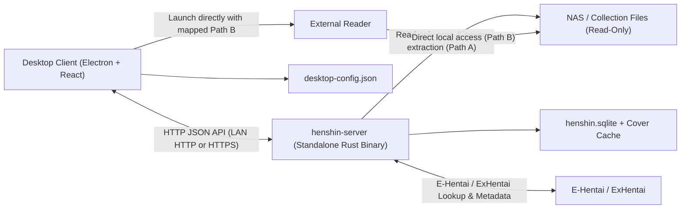

# Henshin Design

Henshin is a personal, single-user desktop application for managing E-Hentai / ExHentai comic collections on a trusted home LAN. It provides read-only indexing, cover thumbnails, EH/ExHentai metadata and tag sync, search, open counting, and cross-device library sharing. Reading always happens in an external reader on the client device.

---

## 1. Product Goals and Boundaries

### Core Goals

- **Independent client/server architecture**: A cross-platform desktop client (**Electron + React + TypeScript**) connects over the LAN (or `localhost` when run on the same machine) to an independently running Rust server (`henshin-server`) hosted on an always-on machine (e.g., a Mac mini or home server). Server and desktop are packaged and run separately.
- **Storage decoupled from server placement**: Collection files stay on a NAS (or any externally managed folder). The server reads them through its own path (e.g., `/mnt/nas/books`), while each desktop accesses the exact same files through its own native mount or network path (e.g., `Z:\Books` on Windows, `/Volumes/Books` on macOS).
- **Strictly read-only collection access**: Henshin never creates, modifies, renames, deletes, repacks, or writes temporary/cache files inside any collection directory.
- **Core workflow**: Index plain `.zip` archives (matching standard EH archive downloads), generate cover thumbnails, look up and sync titles and namespaced tags from both **E-Hentai and ExHentai** while keeping personal edits, search by title/filename (including short CJK text) and tags, open books in a local external reader, and share library metadata and open counts across desktops.
- **Application database backup and archiving**: Create consistent single-file SQLite snapshots for routine backup and long-term archiving, and restore them cleanly. Original comic files are protected by external NAS backup tools.

### Explicit Non-Goals

- No built-in image viewer or page-by-page reader.
- No EH comic downloader, EH favorites sync, or file forwarding/streaming from server to desktop.
- No Electron-bundled server binary, desktop-managed server lifecycle, or opinionated OS service/auto-start installer (users run and supervise `henshin-server` however they prefer on their chosen host).
- No multi-user accounts, roles, or public-internet hostile-network threat model.
- No mandatory HTTPS/CA reverse-proxy setup on a home LAN (plain `http://<lan-ip>:<port>` with a shared token is first-class; HTTPS works transparently if the user puts a proxy in front).
- No offline browsing cache, client-side SQLite database, or offline event/draft recovery queue.
- No automatic source-file organization, renaming, or deletion; EH lookup never runs during a collection scan.

---

## 2. System Architecture



### 2.1 Server (`henshin-server`, Rust)

- **Stack**: Single Rust crate (`server/`) compiled with Cargo to a standalone `henshin-server` binary. Practical starting choices (kept flat and replaceable, not rigid prohibitions):
  - HTTP & async runtime: `axum` + `tokio`
  - Storage: `rusqlite` (bundled SQLite) with WAL mode and foreign keys
  - Archives & imaging: `zip`, `image` (decoding JPEG/PNG/WebP and writing cached JPEG cover thumbnails), and `sha1` for raw first-page cover hashes
  - Upstream EH/ExHentai HTTP & parsing: `reqwest` + `serde`/`serde_json` + HTML parsing (`scraper`)
- **Independent always-on server**:
  - Run `henshin-server serve --data-dir <dir> --listen 0.0.0.0:4317` (or `127.0.0.1:4317` for single-host use) on any always-on machine chosen by the user.
  - On first start (or via `--token`), a random shared bearer token is persisted in `<data-dir>/token` (`0600` on Unix) and required as `Authorization: Bearer <token>` on all `/api/*` endpoints.
  - How the server is kept running (terminal, `launchd`, `systemd`, etc.) is left to the user rather than locked to one host mechanism.
- **Data directory ownership**: The server holds an exclusive lock file inside `<data-dir>` so two server processes cannot open and write the same SQLite database concurrently. All application data (`henshin.sqlite`, `covers/`, `token`, and any server EH/ExHentai credential file) lives inside `<data-dir>`, never inside a collection root.

### 2.2 Desktop Client (Electron + React + TypeScript)

- **Thin Electron main + preload**:
  - Connects to the user's independently running `henshin-server` over HTTP or HTTPS — never bundles or manages the server process.
  - Reads and writes one local JSON file: `desktop-config.json` (`0600` on Unix) under Electron `userData`. No second SQLite database on the desktop.
  - Exposes native folder/executable pickers, local path mapping resolution, external reader launch, and a thin API request bridge to the configured server.
- **React UI**: React + TypeScript UI for browsing, searching, EH/ExHentai candidate lookup and metadata editing, managing roots/scans, and configuring device connection, mappings, and readers (starting with straightforward React state; additional libraries may be adopted only if concrete complexity warrants them).

#### `desktop-config.json` Shape

Example for a desktop connected to an independent LAN server (for a server running on the same machine, set `url` to `http://127.0.0.1:4317`):

```json
{
  "connection": {
    "url": "http://192.168.1.10:4317",
    "token": "shared-bearer-token"
  },
  "mappings": {
    "<root-id>": "/Volumes/NAS/Comics"
  },
  "readers": [
    {
      "id": "uuid",
      "name": "NeeView",
      "mode": "executable",
      "executable": "/Applications/Reader.app/Contents/MacOS/Reader",
      "args": [],
      "isDefault": true
    }
  ]
}
```

---

## 3. Server Data Model

All shared library state lives in `<data-dir>/henshin.sqlite` with `PRAGMA journal_mode = WAL` and `PRAGMA foreign_keys = ON`. Server credentials stay in separate `0600` files inside `<data-dir>` so database backups never contain tokens or login secrets.

```sql
-- Logical collection roots configured on the server
CREATE TABLE roots (
  id TEXT PRIMARY KEY,
  label TEXT NOT NULL,
  server_path TEXT NOT NULL UNIQUE,
  exclusions_json TEXT NOT NULL DEFAULT '[]',
  created_at INTEGER NOT NULL
);

-- Indexed ZIP archives with file facts, EH source fields, personal overrides, and open stats
CREATE TABLE entries (
  id TEXT PRIMARY KEY,
  root_id TEXT NOT NULL REFERENCES roots(id),
  relative_path TEXT NOT NULL,
  status TEXT NOT NULL DEFAULT 'active' CHECK (status IN ('active', 'missing')),
  title TEXT NOT NULL,              -- Derived from filename
  custom_title TEXT,                -- Personal title override (NULL = use EH/default title)
  note TEXT NOT NULL DEFAULT '',    -- Personal note
  page_count INTEGER NOT NULL DEFAULT 0,
  file_size INTEGER,
  file_mtime INTEGER,
  cover_key TEXT,                   -- Filename in <data-dir>/covers/
  cover_sha1 TEXT,                  -- SHA-1 hex digest of raw first-page image bytes (for EH f_shash lookup)
  cover_hash_version INTEGER NOT NULL DEFAULT 0, -- Version of the cover hash calculation; current version is 1
  eh_gid TEXT,
  eh_token TEXT,
  eh_domain TEXT,                   -- 'e-hentai.org' | 'exhentai.org'
  eh_bind_source TEXT CHECK (eh_bind_source IN ('auto', 'manual')), -- NULL until a gallery is bound
  eh_title TEXT,
  eh_title_jpn TEXT,
  eh_refreshed_at INTEGER,
  eh_error TEXT,
  open_count INTEGER NOT NULL DEFAULT 0,
  last_opened_at INTEGER,
  created_at INTEGER NOT NULL,
  updated_at INTEGER NOT NULL,
  UNIQUE(root_id, relative_path)
);

-- Canonical tags separated by origin so EH refreshes never clobber personal edits
CREATE TABLE entry_tags (
  entry_id TEXT NOT NULL REFERENCES entries(id) ON DELETE CASCADE,
  tag TEXT NOT NULL,                -- Canonical 'namespace:name', e.g. 'language:chinese'
  origin TEXT NOT NULL CHECK (origin IN ('eh', 'local', 'hidden')),
  PRIMARY KEY (entry_id, tag, origin)
);

CREATE INDEX idx_entry_tags_tag ON entry_tags(tag, origin, entry_id);

-- Deduplicated open events across devices
CREATE TABLE open_events (
  id TEXT PRIMARY KEY,              -- Client-generated UUID per launch
  entry_id TEXT NOT NULL REFERENCES entries(id) ON DELETE CASCADE,
  opened_at INTEGER NOT NULL
);

CREATE INDEX idx_open_events_entry ON open_events(entry_id, opened_at DESC);
```

### Three-Layer Metadata Precedence

1. **File facts**: `relative_path`, `page_count`, `file_size`, `file_mtime`, `title` (from filename).
2. **EH source metadata**: `eh_title`, `eh_title_jpn`, and `entry_tags` with `origin = 'eh'`.
3. **Personal overrides**: `custom_title`, `note`, and `entry_tags` with `origin = 'local'` or `origin = 'hidden'`.

- **Effective display title**: `custom_title` if set, else the preference-derived EH title, else the filename `title`. With `preferOriginalTitle` enabled, the EH title prefers non-empty `eh_title_jpn` then `eh_title`; by default, it prefers non-empty `eh_title` then `eh_title_jpn`.
- Entry responses expose the preference-derived EH source title as `ehDisplayTitle` and the final personal/source/filename title as `effectiveTitle`. The desktop uses those fields in entry details and library cards.
- **Effective tags**: `(eh tags ∪ local tags) \ hidden tags`.

---

## 4. Core Workflows

### 4.1 Read-Only Scanning and Cover Generation

- **Root registration and removal**: The user enters a directory path visible to the server plus a label (and optional excluded subdirectories such as NAS system folders like `@eaDir` or `#recycle`). The server verifies the directory exists, is readable, does not overlap `<data-dir>`, and does not nest inside or enclose another configured root. A root can be removed only when it has no indexed entries; deleting a non-empty root returns `409 Conflict` so library history cannot be erased accidentally. Root removal never touches files on disk.
- **Server-owned scanning**: `POST /api/roots/:id/scan` starts a background scan task on the server (one active scan per root) and returns immediately. Closing a desktop window or disconnecting never cancels the scan; reconnecting simply queries `GET /api/scans` and `GET /api/entries`.
- **Format scope**: Henshin indexes plain `.zip` archives directly (matching standard EH archive downloads). Additional formats (such as `.cbz` or loose image directories) are out of the initial schema and can be added later if needed.
- **Image ordering and cover extraction**: Inside each `.zip`, filter supported image entries (`JPEG`, `PNG`, `WebP`, ignoring OS metadata entries like `__MACOSX`). Order cover-named images first, ordinary images by natural filename order, and known credit/backmatter images last; natural filename order breaks ties within each group. Count pages, compute the SHA-1 hex digest (`cover_sha1`) of the raw first ordered image bytes before resizing (for EH `f_shash` reverse lookup without a second archive read), and decode that image into a resized JPEG thumbnail (e.g., max width 400px, quality 82) stored in `<data-dir>/covers/<entry-id>-<mtime>-<size>.jpg`. Corrupt or encrypted archives are logged and skipped without aborting the rest of the scan.
- **Incremental rescans and same-path replacement**:
  - Unchanged `(file_size, file_mtime)` entries are skipped quickly.
  - **Replacing a `.zip` at the same `(root_id, relative_path)` is treated as the same book**: the rescan refreshes file facts (`page_count`, `file_size`, `file_mtime`, `cover_key`, `cover_sha1`) while keeping the existing entry `id`, `custom_title`, `note`, EH binding/metadata, personal tag overrides, and `open_count` / `last_opened_at`. The user can trigger EH refresh or rebind manually if needed.
  - Files absent during a completed scan are marked `status = 'missing'` (never auto-deleted), preserving their EH metadata, notes, and open history. If a file reappears at the same path (including a replacement `.zip`), it returns to `active` as the same book and updates its file facts and cover.
  - A traversal error below the root is reported while readable paths continue to index. Entries under an unreadable path keep their prior status; other absent entries can be marked `missing`. If the root itself is unavailable, the scan fails without changing missing status.

### 4.2 E-Hentai / ExHentai Lookup, Metadata, and Tag Sync

Plain `.zip` archives carry no embedded gallery metadata, so candidate lookup against E-Hentai / ExHentai is a core workflow alongside direct gallery URL binding.

- **Candidate lookup and binding**:
  1. **Community lookup preferences**: The server stores the preferred site and language, whether to try cover search first with title search as fallback, whether bracketed filename IDs may be used as gallery IDs, whether to include expunged galleries, whether to prefer the original title, and whether uploader and upload time are included. These settings are editable in desktop Settings. Each completed book lookup in a batch waits the configured 0–20 seconds before starting the next book; the default is 4 seconds. A zero-second interval disables the wait.
  2. **Normal entry lookup**: The preference-based `auto` action omits a site override and uses the server's saved community preferences, including its preferred site. Cover-first lookup falls back to title/filename search when it finds no candidates. It binds the first candidate on an unbound entry and returns the updated entry plus all candidates.
  3. **Explicit title and cover previews**: These actions return candidate previews only; they never bind automatically. Explicit title lookup sends the saved `includeExpunged` preference. Cover lookup has no expunged flag. A chosen one-shot site override applies to the explicit action once, then resets; it does not carry to another entry or the preference-based action.
  4. **Cover image SHA-1 reverse lookup (`f_shash`, optional)**: Cover-based lookup uses the raw first-page image SHA-1 computed during scanning (as used by LANraragi's `f_shash` search with cover/similarity options) and returns preview candidates for user inspection.
  5. **Bracketed gallery ID**: When enabled, a bracketed filename ID can be used as a gallery ID. This is a user-controlled option because bracketed numbers can also be years or volume numbers.
  6. **Direct gallery URL bind / correction**: At any time, the user can paste a valid gallery URL (`/g/<gid>/<token>/` on `e-hentai.org` or `exhentai.org`) to bind directly or rebind/correct an entry without searching.
- **Candidate parsing, rate pacing, and safety**:
  - Parse and return the candidate list. An ordinary `mode:auto` lookup binds the first candidate automatically, returns the updated entry and all candidates, and marks the binding source `auto` so the desktop can label it **Auto-matched**. Explicit `title` and `cover` lookups are previews and do not bind.
  - The user can confirm the auto-match directly from the entry details, choose a different candidate, or bind a direct gallery URL. These choices set the binding source to `manual`; a refresh keeps the existing source. A lookup for an already bound entry uses `autoBind: false` to show alternatives without replacing its binding.
  - Store `eh_bind_source` as `auto`, `manual`, or `NULL` when no gallery is bound. `ehBindSource=auto` filters the library to auto-matched entries; confirming or correcting a match removes the entry from that filtered list. Never run lookup during scans.
  - Enforce the server-saved 0–20 second interval after each completed book lookup in a batch (default 4 seconds), and surface rate-limit or temporary IP-ban responses as clear, non-blocking errors (rather than sleeping synchronously inside request handlers).
  - If E-Hentai returns its “You are opening” warning with candidates, wait 15–50 seconds and then return those results. This warning is distinct from an IP-ban or rate-limit response, which is reported as an error.
  - The desktop batch action selects entries on the current library page and sends sequential `mode:auto`, `autoBind:true` requests. It reports per-book failures and no-match results, waits the saved interval after each nonterminal book only when another is selected, and can be cancelled to stop future requests and a pending wait. It stops on explicit access or rate-limit blocks. Bound entries refresh through the same action while retaining their binding provenance.
- **Dual-site (`e-hentai.org` and `exhentai.org`) core support and credentials**:
  - Both `e-hentai.org` and `exhentai.org` are core supported sites. `e-hentai.org` works without login credentials; `exhentai.org` uses user-provided named login cookies stored outside `henshin.sqlite` in `<data-dir>/eh-settings.json` with `0600` permissions on Unix. Settings expose the saved lookup preferences and whether credentials are configured, never raw cookies. The desktop cookie input is write-only. Sending configured cookies to public `e-hentai.org` searches requires a separate opt-in, disabled by default; that option does not change the preferred search site. Cookies are attached only to opted-in E-Hentai lookup requests or ExHentai HTML lookup requests, and those requests do not follow redirects.
  - Non-HTML, access-denied, login-wall, or unexpected upstream responses are surfaced as explicit **access/upstream errors** distinct from "no search results" (without claiming a single error page uniquely proves cookie expiry), and never disrupt `e-hentai.org` or local library browsing.
  - Upstream HTML search parsing and ExHentai access must be live-verified against authorized galleries during implementation before marking those capabilities complete.
- **Metadata fetch (`gdata`) and self-consistent bind / refresh / rebind**:
  - For each selected or manually bound `(gid, token)`, the server fetches titles and namespaced tags through the EH `gdata` JSON API with one gallery pair per request. This applies to first-result auto-binding, manual confirmation or selection, direct URL binding, and refresh; batch refresh sends one request per book. Check top-level and per-gallery errors, HTML-unescape `title` and `title_jpn`, and store `category:<lowercase>` with namespaced tags as `origin = 'eh'` (optional `uploader:` / `timestamp:` tags stay off by default).
  - **First bind**: Save `(eh_gid, eh_token, eh_domain)` and its `eh_bind_source` (`auto` for the first lookup result, `manual` for a user-confirmed choice or direct URL), then fetch via `gdata`. On success, store `eh_title`, `eh_title_jpn`, `eh_refreshed_at`, and `origin = 'eh'` tags. On failure, keep the binding and source classification, leave `eh_*` metadata empty, and record `eh_error` so the user can retry.
  - **Refresh (same bound gallery)**: On success, replace `eh_*` fields and `origin = 'eh'` tags while preserving `custom_title`, `note`, and `local`/`hidden` tag overrides. On failure, keep the last-known metadata and record `eh_error`.
  - **Rebind (different gallery URL or candidate)**: In one transaction, save the new `(eh_gid, eh_token, eh_domain)` and immediately clear the previous gallery's `eh_title`, `eh_title_jpn`, `eh_refreshed_at`, and `origin = 'eh'` tags (preserving `custom_title`, `note`, and `local`/`hidden` tag overrides), then fetch the new gallery. If that fetch fails, the entry shows the new binding with empty source metadata and `eh_error` — never the previous gallery's tags.
  - Optional Chinese tag translation aliases (e.g., from EhTagTranslation) can be layered later as read-only display and search aliases without altering canonical `namespace:tag` storage.

### 4.3 Search, Filtering, and Sorting

- **Literal text search**: Matches normalized (NFKC + lowercase) substrings against effective title, EH titles (`eh_title`, `eh_title_jpn`), and filename (`relative_path` basename). Uses parameterized SQLite `instr(...)` predicates so 1–2 character CJK queries match accurately without tokenizer gaps.
- **Tag filters**:
  - `includeTags`: entry must have **all** specified tags in its effective tag set.
  - `excludeTags`: entry must have **none** of the specified tags in its effective tag set.
  - Tag autocomplete queries distinct effective tags already present in the library.
- **Additional filters**: storage root and entry status (`active` by default, or `missing`).
- **Sorting and pagination**: Sort by date added (default descending), effective title, open count, or last opened time, with `entries.id ASC` tie-breaker and `limit` / `offset` pagination.

### 4.4 Local Path Mapping, External Reader Launch, and Open Counting

- **Path resolution**: Given an entry's `(root_id, relative_path)`, Electron main looks up `mappings[root_id]` in `desktop-config.json`, joins the relative path using native separators, verifies the resolved path stays inside the mapped root (blocking `..` traversal), and checks that the local file exists.
- **External reader launch**:
  - **Executable mode**: `child_process.spawn(reader.executable, [...reader.args, resolvedPath], { detached: true, stdio: "ignore" })` — direct argument array, never a shell command.
  - **System association mode**: Electron `shell.openPath(resolvedPath)`.
- **Open counting**:
  - Once the OS accepts the launch, the desktop generates a UUID `event_id` and sends `POST /api/entries/:id/open` with `{ event_id, opened_at }`.
  - The request uses `{ event_id, opened_at }`; the server also accepts the earlier camelCase spelling `{ eventId, openedAt }`. In a single SQLite transaction, it executes `INSERT OR IGNORE INTO open_events (...)` and, if inserted, increments `entries.open_count` and sets `entries.last_opened_at` to the newer of its current value and `opened_at`. The response is `{ open_count, last_opened_at }` so the UI refreshes immediately.
  - If the server request fails due to a transient error, the UI shows a brief non-blocking notice and does not relaunch the reader.

### 4.5 Multi-Desktop Sync

- One server instance is the single source of truth for the library, EH metadata, custom titles, notes, tags, and aggregated open counts.
- Connecting a second desktop over the LAN requires entering the server URL and shared token, then configuring that desktop's own local root mappings and reader profile in `desktop-config.json`.
- Edits and open counts persist on the server and appear on other desktops on refresh or navigation.

### 4.6 Application Database Backup and Archiving

- **What is backed up and restored**: The SQLite database (`henshin.sqlite`), containing configured server roots, indexed entries, EH metadata, personal titles/notes/tag overrides, and open history.
- **What is NOT in the database backup**:
  - Original comic files on the NAS (protected externally by NAS snapshots/backups).
  - Server secrets (`token` and any optional ExHentai credential file in `<data-dir>`): when restoring into a fresh `<data-dir>`, re-initialize/re-enter server credentials as needed.
  - Per-desktop `desktop-config.json` (connection URL/token, local path mappings, reader profiles): stays on each desktop and continues working if the server URL/token and root IDs remain the same, or is reconfigured locally on a new machine.
  - Cover cache (`<data-dir>/covers/`): derived cache, cleared after restore and regenerated on a cover request when the source archive still matches its stored size and modification time, or during a root scan. A changed, missing, or unavailable source is not used to recreate an old cover key.
- **Backup / long-term archive command**:
  ```sh
  henshin-server backup --data-dir <dir> --out <output-file.sqlite>
  ```
  Uses SQLite `VACUUM INTO` to write a consistent single-file database snapshot (safe whether the server is running or stopped). Refuses destinations inside any configured collection root and refuses to overwrite an existing output file, supporting both routine backups and dated long-term archives.
- **Restore command**:
  ```sh
  henshin-server restore --data-dir <dir> --in <backup-file.sqlite>
  ```
  Runs only while the server is stopped (acquires the `<data-dir>` lock):
  1. Validates the input file (`PRAGMA integrity_check` and required tables exist) and copies it to a temporary staging file inside `<data-dir>`.
  2. If `<data-dir>/henshin.sqlite` exists, moves it and any existing `-wal`/`-shm` sidecars intact into a timestamped backup folder inside `<data-dir>`. Keep these files together when recovering the previous database.
  3. Moves the staged file into place as `henshin.sqlite` and removes stale files from `<data-dir>/covers/` so covers regenerate cleanly.
  4. Never writes to or modifies any collection root.

---

## 5. HTTP API Surface

All `/api/*` routes require `Authorization: Bearer <token>` and return JSON (except `/api/covers/:key`, which returns `image/jpeg`).

| Method & Path | Purpose |
| --- | --- |
| `GET /api/health` | Verify token and return `{ serverId, version }` |
| `GET /api/roots` | List configured storage roots |
| `POST /api/roots` | Register a new server root (validates readability and path separation) |
| `PATCH /api/roots/:id` | Update root label or exclusions |
| `DELETE /api/roots/:id` | Remove an empty root configuration (non-empty roots return `409`; files on disk are never touched) |
| `POST /api/roots/:id/scan` | Start an independent background scan for a root |
| `GET /api/scans` | Read current/recent scan progress and errors |
| `GET /api/entries` | Search (`q`), filter (`includeTags`, `excludeTags`, `rootId`, `status`, `ehBindSource`), sort, and paginate |
| `GET /api/entries/:id` | Get full entry details including effective tags and overrides |
| `PATCH /api/entries/:id` | Update `custom_title`, `note`, or local/hidden tags |
| `POST /api/entries/:id/open` | Record a deduplicated open event and return updated `{ open_count, last_opened_at }` |
| `POST /api/entries/:id/eh-bind` | Manually confirm or choose an EH/ExHentai gallery URL or candidate and fetch metadata via `gdata` |
| `POST /api/entries/:id/eh-lookup` | `mode:auto` uses saved preferences and binds the first result by default; `title` and `cover` return preview candidates only; `autoBind:false` returns auto-mode alternatives without replacing an existing binding |
| `POST /api/entries/:id/eh-refresh` | Refresh EH source metadata for one entry (or batch via `POST /api/eh/refresh`) |
| `GET /api/settings/eh` | Read server-saved EH lookup preferences and credential status (never returns raw cookies) |
| `PUT /api/settings/eh` | Save EH lookup preferences or clear server-side cookies (`0600` file in `<data-dir>`) |
| `GET /api/tags` | List distinct effective tags (for filter autocomplete) |
| `GET /api/covers/:key` | Serve cached JPEG cover thumbnail |

---

## 6. Desktop UI Layout

Keep the desktop interface clean and focused on three views:

1. **Library (Default View)**
   - **Top bar**: Search input (literal title/filename), include/exclude tag chips with autocomplete, root & status (`active` / `missing`) filters, sort selector, and Refresh button. Batch controls select all entries on the current page, unbound entries on that page, or clear selection; lookup runs sequentially and can be cancelled.
   - **Main grid / list**: Responsive cover cards showing cover image, server `effectiveTitle`, an **Auto-matched** label for automatic bindings, key tags, and open count. The binding-source filter can show only auto-matched entries.
   - **Detail drawer / panel**: Clicking an entry opens details showing cover, server `effectiveTitle` and preference-derived `ehDisplayTitle`, EH titles, filename, page count, effective tags with add/hide controls, personal title and note fields, EH/ExHentai preview candidates and direct gallery URL bind/rebind and refresh actions. Show whether the binding is **Auto-matched** or **Manual match**. The user can confirm an auto-match or choose another candidate; errors stay visible. Include open count and last opened time, reader selector, and primary **Open** button.
2. **Roots & Scans**
   - List of server roots, add/edit exclusions, "Scan now" trigger, and live server scan status/errors.
3. **Settings**
   - **This device**: Server URL + bearer token (LAN host or `localhost`), per-root local folder mapping (native directory picker), and local external reader profiles (executable picker or OS association).
   - **Server**: EH lookup preferences (site, language, search behavior, title preference, optional uploader/time, and 0–20 second batch interval) and write-only cookie settings with a separate opt-in for sending named login cookies to public E-Hentai searches (status display only, never echoing raw cookies), plus backup/archive CLI summary.

---

## 7. Packaging and Delivery Sequence

### Separate Packaging

- **Independent server (`henshin-server`)**: Packaged and distributed separately as a standalone Rust binary with SHA256 checksums. Build and verify target host platforms explicitly (starting with the user's primary server host such as macOS arm64; additional targets such as Linux x64/arm64 or Windows x64 are built and runtime-verified on their target platforms rather than claimed without verification).
- **Desktop app**: Packaged and distributed separately as standalone platform desktop bundles (macOS `.app`/archive, Windows portable `.zip`, Linux `.AppImage` as built and verified) without bundling `henshin-server`. Signing status (unsigned / ad hoc vs release signed) is declared explicitly alongside artifacts.

### Delivery Sequence

1. **Baseline Reset & Core Browse/Open Loop**: Archive v0 and reset baseline; build standalone Rust `henshin-server` (read-only `.zip` scan, `cover_sha1`, JPEG covers, same-path replacement, open counting) and thin Electron/React desktop client (URL+token connection, local path mapping, external reader launch).
2. **Search, Personal Editing & Dual-Site EH/ExHentai**: Literal CJK + effective-tag search and personal title/note/tag overrides; E-Hentai and ExHentai candidate lookup (filename/title + optional `f_shash`) with marked first-result auto-binding, manual confirmation/reselection, direct URL bind/rebind, `gdata` metadata sync, and dual-site cookie settings.
3. **Multi-Desktop LAN Sharing, Database Backup/Restore & Separate Packaging**: Two-desktop LAN verification and scan continuity, SQLite `backup` / `restore` CLI, and separate server/desktop packaging with lean CI. Optional Chinese tag translation aliases can be layered afterward as read-only display/search aliases.

### Ongoing Code Hygiene

- Keep layers flat and avoid introducing extra abstractions, tables, or IPC boilerplate without a concrete user need.
- Periodically pause after completing a milestone or several PRs to review the codebase as a whole, flatten unnecessary wrappers, and remove dead code while keeping core workflows green.
