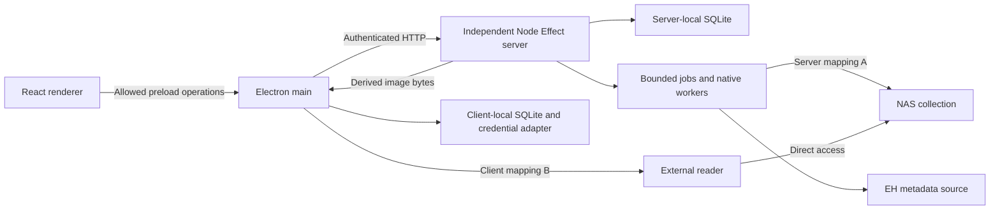

# Architecture, Deployment, Authentication, and Packaging

This topic owns process topology, local-service lifecycle, credentials/TLS, desktop trust boundaries, and distribution. It preserves [product scope](product-scope.md): NAS placement is independent of server placement, and reader launch stays local. Defaults below are deployment proposals; platform/package claims require the [delivery](delivery-and-validation.md) evidence matrix.

[Design overview](../design.md) | [Domain glossary](../../CONTEXT.md)

## Processes and Data Placement

| Component | Authority and durable data |
| --- | --- |
| Server | Authoritative library, roots, claims, metadata/overrides, open history, device labels, tasks, operation results; local SQLite plus regenerable covers/artifacts and protected credential references |
| Electron main | Authenticated clients, local mappings/profiles, launcher, journals, saved drafts, command attempts, bounded display cache, protected connection credentials, owned local-service lifecycle |
| Renderer | Presentation and active view/form state; no Node/native access, database handle, transport credential, or arbitrary fetch/launch capability |
| NAS | Externally managed collection files; application reads them without organization, deletion, or forwarding |

Both service modes run the same independent server program, without importing Electron. Use `apps/desktop`, `apps/server`, and `packages/contracts` as the initial package boundaries; add shared pure-domain code only when actual repeated rules justify it. The server uses Node/TypeScript, Effect application/HTTP direction, and SQLite. Native worker/driver and exact Effect release choices remain constrained by [composition](application-logic.md) and [persistence](data-model.md).

Separate data directories from installed binaries. Server data contains its database, cache, task/artifact storage, nonsecret configuration, and private secret-store references. Desktop data contains its own database/cache and protected credential references. Apply restrictive user/service-account permissions; no world-readable credentials or routine shared writable directory. Logs and temporary outputs stay in application-owned directories, never collection roots. The NAS mount is supplied by the OS/service account and is not created by Henshin. [Source safety](source-safety.md) requires read-only source access, disjoint writable destinations, and effective NAS/account protection for server and external reader; no marker/write probe or automatic permission escalation is allowed.

## Managed Local Service

Electron main holds the desktop single-instance lock for its desktop data directory and coordinates multiple windows. A bundled offline maintenance entry point, invoked explicitly by the local operator with server/desktop store kind, provides backup/restore/verification without starting Electron main, a renderer or network serving. It uses the same storage adapters and exclusive data-directory lock, refuses a running owner, and never kills one to proceed; exact packaged CLI syntax is fixed at G10. Desktop backup is available through this stopped-store entry point, not an IPC action requiring the running app. For local mode it starts the bundled independent server executable/runtime at a known installed resource path with a selected local data directory. Do not search PATH for a server binary, run a shell, or assume the Electron Node ABI matches the standalone Node runtime.

1. Acquire the desktop data-directory lock; inspect the configured server data directory's lock/readiness state without opening its database directly.
2. If no service owns the directory, create a fresh high-entropy session token and start an owned child with a private inherited control/bootstrap channel. Send the token over that channel, never command-line arguments, public rendezvous files, logs, or renderer state. The local child accepts this runtime-only credential and binds loopback only, using an OS-assigned free port.
3. The server acquires its data-directory lock, validates/migrates storage, generates a fresh authority epoch, and reports readiness (port, instance/epoch, API compatibility) only after it can serve. Main performs the authenticated handshake and verifies the expected namespace before exposing the connection as ready.
4. On startup failure/timeout, show the stage and redacted diagnostic. Stop only the child this main process created, allowing bounded graceful cleanup before terminating it; never kill an arbitrary PID from a stale file. Preserve the data directory and any migration recovery materials.
5. If another service already owns the directory, do not start a second writer. Offer connection to that known endpoint with explicit credentials and namespace verification, or ask the user to stop it. Reuse does not grant main ownership or permission to stop an independently started service. A rendezvous record may contain endpoint/PID/instance, never a bearer token; treat it as a hint, not authentication.

On desktop exit, stop new Open/commands, settle bounded local recording, retain pending events/attempts, then request graceful shutdown only of its owned child. Remote or independently started servers continue. The owned child treats closure of its private parent control channel as a shutdown request so desktop crashes do not leave an unmanaged persistent service; it finishes short commits and persists recovery state before exit. Native tests must establish this behavior, including stalled shutdown. The child's transient token is discarded with that process; a restart gets a new token and epoch, without changing the data namespace.

Managed local mode is not a LAN listener and does not publish discovery advertisements. A user who wants other desktops to connect runs the independent service mode with explicit listener/TLS configuration. Multiple saved profiles may still connect to independent local or remote services; local/remote mode does not change the meaning of roots or entries.

## Independent Service and Remote Connectivity

Ship a standalone server distribution with a supported pinned Node runtime or a clearly versioned runtime prerequisite; the packaged desktop must not depend on a separately installed system Node. Initial preferred distribution bundles the independent runtime for predictable ABI. Run the service under a dedicated non-administrative account with read access to its NAS mounts and write access only to its application data/backup destinations. Document manual foreground startup first; optional OS service-manager units follow the same executable/configuration contract. Docker remains optional, not a release prerequisite.

Bind loopback by default. LAN exposure is explicit, authenticated, and HTTPS. The initial remote deployment supports an operator-managed TLS reverse proxy on the same host forwarding to loopback HTTP; externally reachable plain HTTP is rejected by desktop profiles. Direct server TLS may be added after adapter validation but is not needed for the first supported remote path. A proxy on another host requires authenticated/encrypted upstream transport, which is outside this initial same-host proxy recipe.

Use a valid hostname/certificate chain trusted by the client OS or an explicitly configured private CA. Do not ship Ignore certificate errors, downgrade-to-HTTP, or certificate-validation bypass. Connection setup reports TLS failures and explains how to install/configure trust outside the normal request path. Profile URLs reject embedded credentials, fragments, unsupported schemes, and ambiguous authority syntax. Do not follow API redirects with bearer credentials; report endpoint reconfiguration instead. Reverse proxies must disable inappropriate buffering for SSE and preserve documented API body/timeout limits.

The prototype server ownership lock covers the real local directory containing the configured database. Startup resolves an existing database-file symlink to its target, resolves the existing parent directory for a new database, and rejects a dangling database-file symlink, then holds a `BEGIN IMMEDIATE` SQLite transaction on a separate `.henshin-server-owner.sqlite` guard database in that directory. The transaction reserves the guard database's sole writer slot for the process lifetime; it does not require SQLite `EXCLUSIVE` transaction mode. Acquisition precedes database-worker initialization and readiness; release follows worker cleanup. The guard database is never unlinked, and startup never creates a missing data directory. This measured prototype covers macOS arm64 with Node 24 and the bundled Electron Node runtime; it makes no hardlink, mount-alias, NAS, or cross-platform locking claim. It cannot prevent a copied database on another machine from sharing an instance ID. [Consistency](synchronization.md) defines migration/clone/restore and observed-overlap checks; operators must stop the old authority before migration and initialize clones before serving. Public-Internet hosting, multi-user isolation, and untrusted plugin execution are not first-release deployment promises.

## Authentication and Secret Handling

Use bearer credentials for one-user administrative access, without introducing account/role models. Independent-service initialization generates a cryptographically random 256-bit owner token, reveals it only through the explicit local initialization flow, and persists only its verification hash in restricted server authentication state. Tokens are not passwords chosen by users; compare fixed-size verifier values in constant time. All API routes, covers, SSE, settings, history, and maintenance artifacts require authentication. No token in query strings or URLs, no cookie-based implicit browser session, and no unauthenticated library-health endpoint leaking metadata.

Independent-token rotation is an explicit local operator command with the service stopped and its data-directory lock held exclusively; replace the verifier transactionally, then restart with a new epoch. Existing streams are closed by shutdown; clients pause and request the new credential. Loss of a token is recovered through local operator access, not an unauthenticated network reset. Managed-child bootstrap credentials are ephemeral and accepted only in that owned loopback process; they are never written as the independent service's owner token. Instance IDs and device IDs grant no authority.

To enable independent access for an existing managed-local library, stop its owned child and run the same local owner-token initialization under the exclusive data-directory lock. Preserve the instance and collection records; generate and reveal a fresh owner token before starting independent mode. Independent startup without an initialized verifier fails closed. A managed bootstrap token never becomes a persistent owner credential.

Main stores remembered connection tokens through an OS-protected credential adapter. Inspect the actual backend: Electron's [safeStorage documentation](https://www.electronjs.org/docs/latest/api/safe-storage) warns that Linux `basic_text` does not protect secrets when no secret store is available. Never silently persist through that backend; offer session-only credentials or require a functioning keyring. Select the API supported by the pinned Electron version rather than copying older synchronous examples. The current upstream documentation and [security guidance](https://www.electronjs.org/docs/latest/tutorial/security) were inspected on 2026-10-18, not tested on all platforms.

Server EH cookies and related secrets use an operator-managed protected secret file/store or service-manager secret facility, with restrictive permissions and a stable opaque version reference in SQLite. Headless permission-restricted files are not claimed to be encrypted vaults. Prepare a new immutable secret version, then atomically activate its reference/generation as persistence requires; obsolete active requests lose publication authority. Credentials never enter ordinary metadata export, logs, error details, saved drafts, or client command-attempt summaries.

Credential-changing command deduplication also must not copy plaintext secrets into `operation_results`. Store nonsecret canonical fields plus a protected immutable secret-version reference, retaining that protected version through the operation's retry window. Compare the complete logical payload, loading protected values only inside the credential adapter; a redacted marker or hash alone cannot claim payload equality. Failure to prepare a protected version leaves the old configuration unchanged. Retire unreferenced versions only after no active configuration/request/result still needs them.

Backup bundles exclude EH cookie/token-secret contents and desktop connection credentials by default; include their nonsecret references/configured status and document reattachment or re-entry after restore/migration. Gallery locator tokens and metadata may still appear in the private database backup, so exclusion does not make the bundle public. Independent owner-token verifiers may exist in snapshots but are never restored as active authentication state. Supported restore, authority migration, and clone preparation clear the copied verifier under the exclusive lock before activating the prepared store. Independent mode then requires local initialization of a fresh token before serving; managed mode uses only its new transient bootstrap token. This also applies to rollback to a pre-upgrade backup. An epoch change alone does not revoke a bearer token. Raw snapshot copying followed by ordinary startup is not a supported restore procedure. The same preparation clears the active EH secret-version reference and marks EH credentials unconfigured, even if an old version remains accessible in the external secret store. Retained references are diagnostic only; neither recovered tasks nor operation results may reactivate them. Credential-dependent EH work remains blocked until explicit re-entry or operator-approved reattachment creates a new immutable version and fresh request generation; never silently fall back to an old version or anonymous access. Public metadata already stored remains usable. Operators protect/transfer backups separately; automated cloud upload or key escrow is not part of this release. [Backup and archival recovery](backup-and-archive.md) defines verified publication, protected retention classes, independent desktop snapshots, inactive restored local settings and isolated restore drills.

## Electron and Content Boundaries

Load packaged UI from a controlled application origin. Enable context isolation and renderer sandboxing; disable Node integration, webviews, arbitrary navigation, and untrusted popup windows. Validate each IPC sender frame/window and origin plus request schema. Preload exposes only the capabilities in [contracts](api-and-tasks.md), never `ipcRenderer`, arbitrary filesystem methods, or generic authenticated fetch. Main verifies the selected profile/namespace/action context even when a renderer supplied a syntactically valid request.

Production CSP starts with `default-src 'none'`, `script-src 'self'`, `style-src 'self'`, `img-src 'self' blob:`, `font-src 'self'`, `connect-src 'none'`, `object-src 'none'`, `base-uri 'none'`, and `frame-src 'none'`. Use packaged styles/assets and main-mediated networking; no `unsafe-eval`, remote scripts, or remote HTML. Any UI-library need for inline styles must be resolved with a narrow tested policy rather than enabling arbitrary script execution. Development tooling has an isolated development policy that cannot ship in production. Blob image URLs are created only from bounded allowlisted image bytes and revoked as [composition](application-logic.md) requires.

Render metadata/paths as text, sanitize expected display formatting, and validate EH external links against the exact source-host/path contract before passing to the system browser. Generic shell `openExternal` is not a permission to open arbitrary protocol URLs. Reader executables/arguments remain locally configured and all targets pass native containment checks. Henshin does not sandbox the external reader's later navigation.

On the server, reject unexpected browser origins and do not enable permissive CORS. Main's native HTTP client does not need browser CORS exemptions. Listener host validation and bearer authentication protect loopback from browser-origin attacks; network requests without valid authentication never perform settings or filesystem mutations. EH fetch hosts, redirects, rate policy, and decoder limits follow [EH](eh-metadata.md) and [indexing](file-indexing.md). Secret-bearing URLs/headers and collection titles/paths are redacted from routine logs; explicit local diagnostics may reveal selected details with a clear preview.

## Packaging, Compatibility, and Upgrades

Proposed packaging uses an established Electron packager (initial candidate: electron-builder) plus independent server artifacts. Target Windows installer/portable development build, macOS application/DMG, and Linux AppImage as initial desktop formats; final architecture/OS support is only what the tested matrix advertises. Code signing and macOS notarization are release requirements where the distribution channel expects them, with credentials supplied by the release operator. They are not available or validated in this design work.

Bundle native SQLite/codec modules for their actual runtime and target architecture. Main's Electron ABI and the independent server's Node ABI require separate build/rebuild validation; do not share one compiled native artifact blindly. If a codec requires external executables, ship/document validated binaries and distribution licenses rather than invoking arbitrary PATH tools. ZIP/CBZ and supported image directories are required; RAR/7z remain conditional. Archive/image workers inherit only necessary environment and filesystem capability, with bounded resources and owned process cleanup.

Client and server negotiate API major compatibility and capabilities before entering the library. A packaged local server is upgraded with its desktop build and uses the selected compatible schema version; remote versions may differ only within an explicitly tested API compatibility matrix. Unknown API major or unsupported database schema stops mutation/startup with instructions. Do not auto-download/upgrade a remote server or downgrade its database from a desktop connection.

For an upgrade: stop admission/owned service cleanly, produce the required consistent pre-migration backup, install binaries without overwriting data, migrate exclusively, then run readiness/handshake. If migration/startup fails, keep the old data and diagnostic/backup paths; manual rollback restores the compatible backup together with compatible binaries rather than opening a new schema with old code. Uninstall removes binaries, but preserves application data unless the user explicitly requests its removal. No uninstaller touches collection roots. Automatic update delivery is deferred; first-release upgrades are explicit downloaded/signed releases with published checksums and compatibility notes.

## Acceptance and Remaining Gates

Validate owned-child bootstrap/readiness/timeout/orphan shutdown, connection to an independently running service without taking ownership, data locks and stale rendezvous handling, loopback auth, remote TLS/proxy SSE, token rotation and rejection of old tokens after restoring a pre-rotation backup, managed-to-independent credential initialization, keyring-unavailable behavior, secret redaction, backup reattachment without reuse of pre-rotation EH secret references, production CSP and IPC sender rejection, two runtime ABIs, codec distribution licenses, and upgrade/restore rollback. Test actual Windows/macOS/Linux packaging and NAS account permissions; framework selection alone proves none of these.

Before implementation, pin runtime/packager versions, concrete credential adapters, local control-channel/lock primitives, signed build formats/architectures, process cleanup deadlines, and supported proxy instructions. [Delivery](delivery-and-validation.md) records evidence and unsupported combinations. No installers, signatures, keyring tests, remote service, TLS proxy, or native packaging validation were produced by this documentation task.
