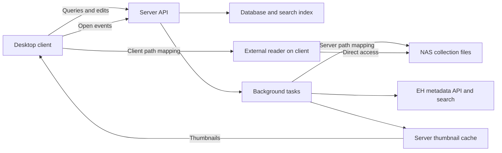

# Architecture and Deployment

This document owns deployment modes, component responsibilities, process boundaries, and technology choices. File storage remains independent of server placement.

[Design overview](../design.md) | [Domain glossary](../../CONTEXT.md)

## Deployment and Responsibilities



| Component | Responsibilities | Stored data |
| --- | --- | --- |
| Server | Scanning, file analysis, cover extraction, EH access, queries and updates, statistics, task scheduling | Library database, EH bindings and metadata, tags, local overrides, open events, tasks, thumbnails, server mappings |
| Desktop client | User interaction, local path resolution, accessibility checks, reader launch, event submission | Server connections, device mappings, reader configuration, display cache, pending events |
| NAS | Store collection files and provide access to devices | Archives and image directories |

In local mode, the client starts the server process shipped with the application and connects over the loopback interface. Remote mode connects to an independently running server. Both modes use the same API and business logic. Clients do not access the server database directly.

The database resides on the server machine's local disk, and thumbnails reside in the server data directory. The NAS stores collection files. Moving the server requires migrating the database and necessary configuration, then configuring its root paths again without changing entry identities. Server migration does not overwrite client mappings. A migration requires stopping the old authority; independently running copies follow the separate clone identity rules in [Cross-device consistency](synchronization.md).

## Technology Choices

The desktop stack is Electron + React + TypeScript, with Effect preferred for application logic in both the frontend and server. The proposed backend remains an independent Node.js/TypeScript server with SQLite. Client and server share transport schemas and API declarations. Validate packaging, native dependencies, and NAS access across Windows, macOS, and Linux without treating the selected desktop framework as an open choice.

The proposed HTTP stack is Effect HttpApi with a compatible Node adapter. Its version constraints and integration checks are owned by [Application logic with Effect](application-logic.md). The server is an independent program with no Electron runtime dependency. Local mode starts that program from the desktop application; remote mode can run it directly or through a Docker deployment. Packaging details remain to be validated.

React runs in the Electron renderer and implements the library, search, entry details, matching queue, and task screens. The Electron main process handles device path resolution, file accessibility checks, external reader launch, and local server lifecycle. Expose these local capabilities through a narrow preload bridge with context isolation enabled and renderer Node.js integration disabled. Scanning, database access, and EH synchronization remain in the independent server, which must run without Electron.

## Connection and Process Boundaries

Use HTTP APIs with authentication and HTTPS for remote connections. Local servers bind to loopback by default and use local connection credentials. Apply consistent access control to library details, covers, settings, and events. Initial authentication serves one user without expanding into a multi-user permission system. Treat file paths and remote metadata as data, never as arbitrary commands or unsanitized executable HTML.

## Module Organization

Proposed code organization by responsibility, without creating placeholder implementations yet:

```text
apps/
  desktop/           UI, device mappings, reader launch, display cache, pending events
  server/            API, scanning, thumbnails, EH access, search, statistics, tasks
packages/
  contracts/         Shared transport schemas, API declarations, and public errors
docs/
  design.md          Design overview and topic index
  design/            Individual topic specifications
CONTEXT.md           Domain glossary
```

Use actual side-effect boundaries such as filesystem access, EH access, persistence, and reader launch to define modules. Initially, background tasks run within the server process without a separate message broker or general-purpose plugin framework.

## Open Design Questions

- How does the desktop application discover, start, reuse, and stop its local server process?
- What is the initial authentication and credential-storage flow for local and remote connections?
- Which client/server version combinations are supported, and how are incompatible versions reported?

Effect composition, runtime lifetimes, and frontend binding choices are specified in [Application logic with Effect](application-logic.md).

## Related Topics

- [Path mappings](path-mapping.md) define file access. [Data model](data-model.md) defines persistence. [API and tasks](api-and-tasks.md) owns contracts and background execution. [Delivery](delivery-and-validation.md) owns packaging checks.
